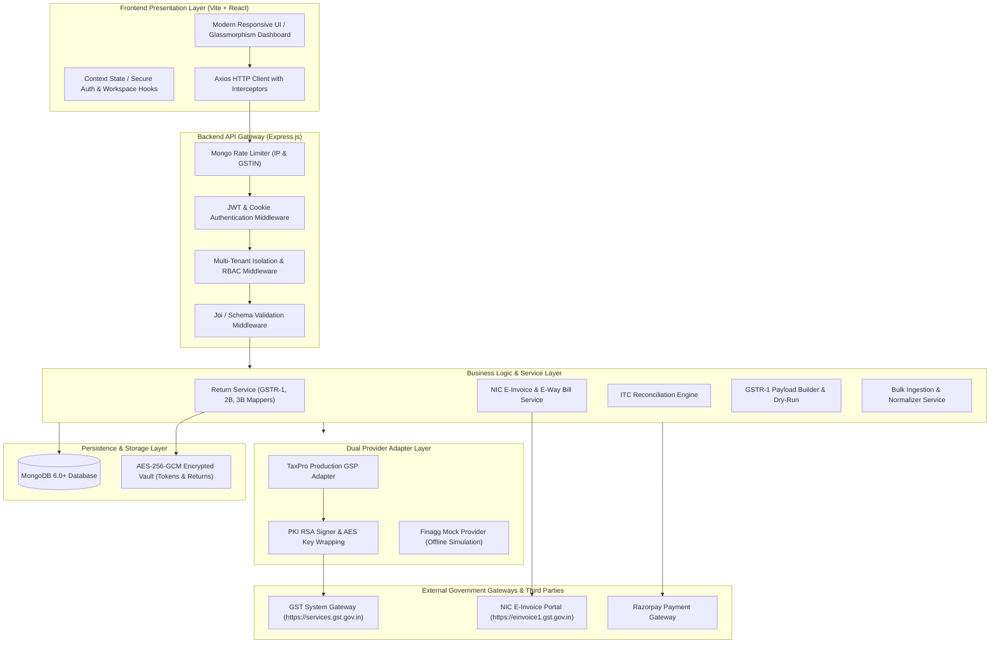
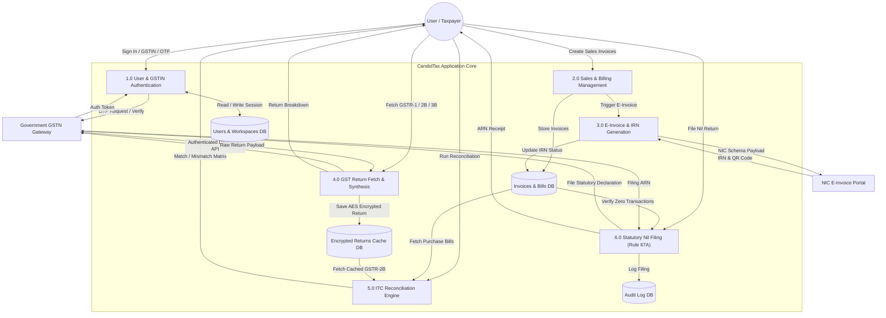
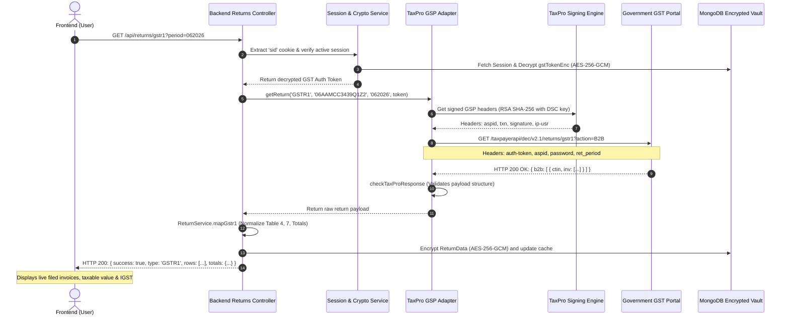
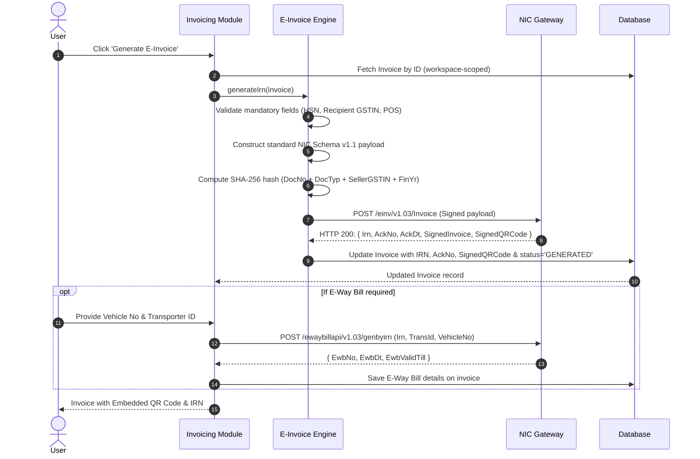

# CandidTax — Enterprise GST Billing & Compliance Platform

> **A production-ready, multi-tenant GST billing, compliance, automated return filing, e-invoicing (NIC IRN / QR Code), e-way bill management, and ITC reconciliation platform.**

---

## 📑 Table of Contents

1. [Executive Summary](#-executive-summary)
2. [Key Features & Capabilities](#-key-features--capabilities)
3. [System Architecture & Design](#-system-architecture--design)
4. [Data Flow Diagrams (DFD)](#-data-flow-diagrams-dfd)
   - [Level 0: Context Diagram](#level-0-context-diagram)
   - [Level 1: System Data Flow Diagram](#level-1-system-data-flow-diagram)
   - [Level 2: Live GST Return Ingestion Flow](#level-2-live-gst-return-ingestion-flow)
   - [Level 2: NIC E-Invoice & E-Way Bill Lifecycle](#level-2-nic-e-invoice--e-way-bill-lifecycle)
5. [Technology Stack](#-technology-stack)
6. [Project Directory Structure](#-project-directory-structure)
7. [Database Schema & Data Models](#-database-schema--data-models)
8. [API Endpoints Reference](#-api-endpoints-reference)
9. [Security, Encryption & Statutory Compliance](#-security-encryption--statutory-compliance)
10. [Local Development & Setup Guide](#-local-development--setup-guide)
11. [Automated Testing Suite (14/14 Suites)](#-automated-testing-suite)
12. [Troubleshooting & FAQ](#-troubleshooting--faq)
13. [License & Attribution](#-license--attribution)

---

## 🌟 Executive Summary

**CandidTax** is an enterprise-grade GST billing, compliance, and filing software engineered for Indian businesses, tax professionals, and enterprises. It bridges financial accounting with the Government GST System (**GSTN**) and National Informatics Centre (**NIC**) portals.

The platform provides a dual-provider architecture:
1. **Production Mode (`PROVIDER=taxpro`)**: Live, direct integration with Government GST servers via **TaxPro GSP/ASP** with PKI RSA signing, AES session key wrapping, live OTP verification, and high-performance return mappers.
2. **Sandbox / Mock Mode (`PROVIDER=mock`)**: An offline, zero-dependency mock simulator replicating official GSTN schemas, rate-limiting, edge-case error codes, and failover states for automated CI/CD testing.

---

## 🚀 Key Features & Capabilities

### 1. Invoicing & Billing Engine
- **Intelligent Tax Computation**: Automatically identifies Inter-State vs. Intra-State transactions based on Place of Supply (POS) and Seller/Buyer state codes, calculating appropriate **CGST + SGST** (50/50 split) or **IGST** (100%).
- **Multi-Line Invoicing**: Line-item level HSN/SAC codes, quantities, units, discount percentages, and cess amounts.
- **Reverse Charge Mechanism (RCM)**: Fully compliant flags for reverse-charge inward and outward supplies.
- **Export Invoices**: Support for With-Payment and Without-Payment of tax (LUT).

### 2. NIC E-Invoicing & E-Way Bill Integration
- **Real-time IRN Generation**: Real-time generation of 64-character Invoice Reference Numbers (IRN) via NIC schema v1.1.
- **Signed QR Code & Digital Signature**: Embeds cryptographically signed QR codes and digital signatures on invoices for mobile verification.
- **E-Way Bill Generation**: Direct creation of Part-A and Part-B E-Way bills linked directly to the IRN.
- **Statutory Cancellation**: Cancellation within 24 hours with mandatory statutory cancellation reason codes.

### 3. GST Returns Management (Live Government Portal)
- **GSTR-1 (Outward Supplies)**:
  - Fetches Table 4 (B2B Supplies), Table 7 (B2CS), Table 12 (HSN Summary), and Table 13 (Documents Issued).
  - Automatically synthesizes GSTR-1 return payloads from recorded sales invoices with offline dry-run validation.
- **GSTR-2B (Auto-Drafted ITC Statement)**:
  - Fetches vendor-filed ITC invoices directly from the GST portal.
  - Granular breakdown of Eligible ITC (All other ITC, Import of goods, Inward supplies liable to reverse charge).
- **GSTR-3B (Monthly Summary Liability)**:
  - Comprehensive view of tax liabilities (Section 3.1) and Input Tax Credit availed (Section 4).
- **Return Filing History & Status**:
  - Live GSTN `RETTRACK` integration showing real-time filing status (`Filed`, `Active`) and official ARNs.
- **Nil Return Filing (CGST Rule 67A)**:
  - Automated pre-check for Nil activity (zero sales, zero purchases, zero liability) with one-click direct statutory filing.

### 4. Smart ITC Reconciliation Engine
- Automatically matches **Purchase Register (Books)** against **Government GSTR-2B**:
  - `MATCHED`: Invoice number, date, tax amounts, and GSTIN match within tolerance.
  - `MISMATCHED`: Partial match (variance in taxable value or tax amounts).
  - `MISSING_IN_2B`: Claimed in books but vendor has not filed (Vendor Risk Audit).
  - `EXTRA_IN_2B`: Available on portal but not yet claimed in books.
- **GST Refund & Liability Estimator**: Real-time estimation of net cash tax payable vs. ITC carry-forward/refund.

### 5. Multi-Tenant Workspace & Role-Based Access Control (RBAC)
- Multi-organization support: Each workspace strictly binds to a single verified **GSTIN**.
- Team hierarchy: `OWNER` (full administrative rights), `ADMIN`, `MEMBER`, and `VIEWER` (read-only audit).
- Cryptographic tenant isolation enforcing workspace boundaries across all database queries.

### 6. Bulk Data Ingestion & Financial Reports
- Excel/CSV bulk import for sales invoices and purchase bills with automated customer creation and schema validation.
- Exportable Sales Register, Purchase Register, and GSTR-1 vs. GSTR-3B Variance Audit Reports.

---

## 🏗️ System Architecture & Design

The application follows a decoupled client-server architecture built on modern web standards:



---

## 📊 Data Flow Diagrams (DFD)

### Level 0: Context Diagram

```mermaid
graph LR
    TaxpayerUser((Taxpayer / Accountant))
    Platform[CandidTax GST Compliance Platform]
    GSTNPortal["Government GST System (GSTN)"]
    NICEInvoice["NIC E-Invoice & E-Way System"]
    PaymentGateway["Razorpay Billing Engine"]

    TaxpayerUser -->|1. Credentials, Invoices & Return Requests| Platform
    Platform -->|2. Invoices, Filed Returns, Reports & Reconciliation| TaxpayerUser

    Platform -->|3. GSP Authenticated Requests (OTP, RETTRACK, RETSUM, B2B)| GSTNPortal
    GSTNPortal -->|4. Decrypted Return Data, Filing Status & ARNs| Platform

    Platform -->|5. NIC Inward Schema v1.1 Payload| NICEInvoice
    NICEInvoice -->|6. 64-char IRN, Signed QR Code, Ack No| Platform

    Platform -->|7. Subscription Orders| PaymentGateway
    PaymentGateway -->|8. Payment Webhook Confirmations| Platform
```

---

### Level 1: System Data Flow Diagram



---

### Level 2: Live GST Return Ingestion Flow



---

### Level 2: NIC E-Invoice & E-Way Bill Lifecycle



---

## 💻 Technology Stack

| Domain | Technology / Library | Purpose |
| :--- | :--- | :--- |
| **Frontend Framework** | React 18.3 + Vite 8.3 | High-performance SPA with instant HMR and optimized asset bundling |
| **Frontend Routing** | React Router DOM v6 | Client-side routing, protected auth guards, workspace switches |
| **Styling & Design** | Vanilla CSS + Bootstrap Icons | Glassmorphic design system, responsive layouts, zero bloat |
| **Backend Runtime** | Node.js (v18+ / v20+ / v22+) | Scalable asynchronous runtime environment |
| **Backend Framework** | Express.js 4.x | RESTful API server with custom security middlewares |
| **Database** | MongoDB 6.0+ via Mongoose 8.x | Multi-tenant document database with automated TTL indexing |
| **Cryptography** | Node.js Native `crypto` | AES-256-GCM envelope encryption for tokens and returns data |
| **PKI & Digital Signatures**| Node.js `crypto.createSign` | RSA-SHA256 signatures for TaxPro GSP authorization |
| **Authentication** | JWT (`jsonwebtoken`), `bcryptjs`, Google Auth | Session management, password hashing, OAuth2.0 |
| **Rate Limiting** | Custom MongoDB Rate-Limit Store | Distributed rate-limiting across multi-instance clusters |
| **HTTP Client** | Axios | Resilient HTTP requests with custom timeouts and error masks |
| **Testing Engine** | Node.js Test Runner (`node:assert`) | 14 test suites, 0-leak credential verification, 100% assertions |

---

## 📁 Project Directory Structure

```text
GST_Compliance/
├── README.md                           # Comprehensive Project Documentation
├── doc/                                # API schemas and sample sandbox payloads
│   ├── einvoice-sandbox-testing.json
│   └── otprequest-error.json
│
├── Backend/                            # Node.js Express REST API
│   ├── server.js                       # Application entrypoint & graceful shutdown
│   ├── package.json                    # Backend dependencies & script definitions
│   ├── .env.example                    # Sample environment variables
│   │
│   ├── scripts/                        # Automated testing & operational tools
│   │   ├── run-all-tests.js            # Unified test runner (14 suites)
│   │   ├── test-taxpro.js              # Comprehensive TaxPro adapter tests
│   │   ├── test-middleware.js          # Security & rate-limiting tests
│   │   ├── test-einvoice.js            # NIC E-Invoice & EWB tests
│   │   ├── test-billing.js             # Tax calculations & tenancy isolation
│   │   ├── test-nil-return.js          # CGST Rule 67A statutory tests
│   │   └── ...                         # Additional test suites
│   │
│   └── src/
│       ├── app.js                      # Express middleware setup & route mounting
│       ├── config/                     # Configurations (env, mongo, constants)
│       ├── controllers/                # Request handlers (auth, returns, invoices, etc.)
│       ├── middleware/                 # Auth, workspaceRole, rateLimiter, validators
│       ├── models/                     # Mongoose Schemas (User, Workspace, Invoice, Return...)
│       ├── routes/                     # Express route definitions
│       ├── services/                   # Core business logic services
│       │   ├── providers/              # GSP/ASP integrations (taxpro.js, taxproGspSession.js)
│       │   ├── einvoice.service.js     # NIC IRN & E-Way Bill operations
│       │   ├── return.service.js       # GSTR-1, 2B, 3B mappers & encrypted caching
│       │   ├── reconciliation.service.js# ITC Matching & Variance Engine
│       │   ├── gstr1.service.js        # GSTR-1 Payload Builder & Dry-Run
│       │   └── finagg.service.js       # Unified provider abstraction interface
│       └── utils/                      # Helper utilities (crypto, apiError, logger, testHooks)
│
└── Frontend/                           # React + Vite Single Page Application
    ├── index.html                      # HTML5 entrypoint with SEO meta tags
    ├── package.json                    # Frontend dependencies & build commands
    ├── vite.config.js                  # Vite configuration & dev server proxy
    │
    └── src/
        ├── main.jsx                    # React root mount
        ├── App.jsx                     # Route registry & global layout
        ├── index.css                   # Global design system & token definitions
        ├── api/                        # Axios API client modules
        ├── components/                 # Reusable UI components (Navbar, Sidebar, Modals...)
        ├── context/                    # React Context (AuthContext, WorkspaceContext)
        ├── hooks/                      # Custom hooks (useReturns, useInvoices, useTaxpayer)
        ├── pages/                      # Application views & dashboards
        │   ├── LandingPage.jsx         # Marketing landing page
        │   ├── LoginPage.jsx           # User authentication & GST OTP modal
        │   ├── DashboardPage.jsx       # Business metrics & compliance snapshot
        │   ├── InvoicesPage.jsx        # Invoice creation, view, IRN & EWB actions
        │   ├── ReturnDetailPage.jsx    # GSTR-1, GSTR-2B, GSTR-3B line-item tables
        │   ├── ReturnSummaryPage.jsx   # Filing history & status overview
        │   ├── ReportsPage.jsx         # Sales/Purchase registers & reconciliation
        │   ├── ExcelImportPage.jsx     # Bulk spreadsheet ingestion
        │   └── TaxpayerSearchPage.jsx  # Public GSTIN search tool
        └── utils/                      # Formatting, number to words, tax calculations
```

---

## 🗄️ Database Schema & Data Models

### 1. `User` Model
```javascript
{
  name: { type: String, required: true },
  email: { type: String, required: true, unique: true, index: true },
  password: { type: String, select: false }, // Bcrypt hash (12 rounds)
  googleId: { type: String, sparse: true },
  role: { type: String, enum: ['SUPER_ADMIN', 'USER'], default: 'USER' },
  status: { type: String, enum: ['ACTIVE', 'SUSPENDED'], default: 'ACTIVE' }
}
```

### 2. `Workspace` Model (Multi-Tenancy Root)
```javascript
{
  name: { type: String, required: true },
  gstin: { type: String, required: true, unique: true, uppercase: true, index: true },
  tradeName: { type: String },
  legalName: { type: String },
  pan: { type: String, index: true },
  stateCode: { type: String, required: true }, // e.g. "06" (Haryana)
  plan: { type: String, enum: ['FREE', 'PRO', 'ENTERPRISE'], default: 'FREE' },
  status: { type: String, enum: ['ACTIVE', 'INACTIVE'], default: 'ACTIVE' }
}
```

### 3. `Session` Model (GST Portal Auth)
```javascript
{
  userId: { type: ObjectId, ref: 'User' },
  workspaceId: { type: ObjectId, ref: 'Workspace', index: true },
  memberId: { type: ObjectId, ref: 'WorkspaceMember' },
  gstin: { type: String, required: true },
  username: { type: String, required: true },
  gstTokenEnc: { type: String }, // AES-256-GCM Encrypted Token (Never stored in plaintext)
  expiresAt: { type: Date, required: true, index: { expires: 0 } } // Auto-deleted on TTL expiry
}
```

### 4. `Invoice` Model (Sales & E-Invoice)
```javascript
{
  workspaceId: { type: ObjectId, ref: 'Workspace', required: true, index: true },
  invoiceNumber: { type: String, required: true },
  invoiceDate: { type: Date, required: true },
  customerId: { type: ObjectId, ref: 'Customer' },
  billingAddress: { line1: String, city: String, state: String, stateCode: String, pincode: String },
  pos: { type: String, required: true }, // Place of Supply (2-digit state code)
  reverseCharge: { type: Boolean, default: false },
  items: [{
    itemId: { type: ObjectId, ref: 'Item' },
    description: String,
    hsnCode: String,
    quantity: Number,
    rate: Number,
    taxRate: Number, // 0, 5, 12, 18, 28
    taxableValue: Number,
    cgstAmount: Number,
    sgstAmount: Number,
    igstAmount: Number,
    cessAmount: Number,
    total: Number
  }],
  totals: {
    taxableValue: Number,
    cgst: Number,
    sgst: Number,
    igst: Number,
    cess: Number,
    grandTotal: Number
  },
  // NIC E-Invoice & E-Way Bill fields
  einvoiceStatus: { type: String, enum: ['NOT_APPLICABLE', 'PENDING', 'GENERATED', 'CANCELLED'], default: 'NOT_APPLICABLE' },
  irn: { type: String, index: true },
  ackNo: { type: String },
  ackDate: { type: Date },
  signedQrCode: { type: String },
  ewayBillNo: { type: String },
  ewayBillDate: { type: Date }
}
```

### 5. `Return` Model (Cached Government Payload)
```javascript
{
  workspaceId: { type: ObjectId, ref: 'Workspace', index: true },
  gstin: { type: String, required: true, uppercase: true, index: true },
  type: { type: String, enum: ['GSTR1', 'GSTR2B', 'GSTR3B'], required: true },
  period: { type: String, required: true }, // MMYYYY format (e.g. "062026")
  dataEnc: { type: String, required: true }, // AES-256-GCM Encrypted Return Data
  fetchedAt: { type: Date, default: Date.now }
}
```

---

## 📡 API Endpoints Reference

### 🔐 1. Authentication & Workspace Management

| Method | Endpoint | Description | Auth Required |
| :--- | :--- | :--- | :--- |
| `POST` | `/api/auth/signup` | Register a new user account | No |
| `POST` | `/api/auth/signin` | Login with email and password | No |
| `POST` | `/api/auth/google` | Sign in with Google OAuth token | No |
| `GET` | `/api/auth/me` | Fetch active user profile and GST session | Yes (Cookie) |
| `POST` | `/api/auth/logout` | Revoke session and clear cookies | Yes (Cookie) |
| `GET` | `/api/auth/workspaces` | List all workspaces accessible by user | Yes (Cookie) |
| `POST` | `/api/auth/workspace/switch` | Switch active workspace context | Yes (Cookie) |

#### GST Portal Authentication (Statutory Access)
| Method | Endpoint | Description | Auth Required |
| :--- | :--- | :--- | :--- |
| `POST` | `/api/auth/otp/request` | Dispatch 6-digit OTP to registered portal mobile/email | Yes (`consent: true`) |
| `POST` | `/api/auth/otp/verify` | Verify OTP, receive GST auth token, encrypt into session | Yes |
| `POST` | `/api/auth/token/refresh`| Silently refresh active GST auth token | Yes |
| `POST` | `/api/auth/otp/evc` | Request EVC OTP for electronic filing verification | Yes |

---

### 🔍 2. Public GSTIN Search
| Method | Endpoint | Description | Auth Required |
| :--- | :--- | :--- | :--- |
| `POST` | `/api/gstin/search` | Search taxpayer legal name, status, and trade name | No (Rate-limited) |

---

### 📑 3. GST Returns Operations

| Method | Endpoint | Description | Parameters |
| :--- | :--- | :--- | :--- |
| `GET` | `/api/returns/summary` | Return filing overview across years | `?period=MMYYYY` |
| `GET` | `/api/returns/gstr1` | Fetch live GSTR-1 return breakdown | `?period=MMYYYY` |
| `GET` | `/api/returns/gstr1/prepare` | Build GSTR-1 JSON schema from local invoices | `?period=MMYYYY` |
| `POST` | `/api/returns/gstr1/save` | Upload/Save GSTR-1 payload to GSTN | `?period=MMYYYY` (dryRun default) |
| `GET` | `/api/returns/gstr2b` | Fetch live auto-drafted GSTR-2B ITC statement | `?period=MMYYYY` |
| `GET` | `/api/returns/gstr3b` | Fetch live GSTR-3B monthly liabilities & ITC | `?period=MMYYYY` |
| `GET` | `/api/returns/nil-eligibility`| Check statutory eligibility for Nil return | `?period=MMYYYY&type=GSTR1` |
| `POST` | `/api/returns/nil-file` | Direct statutory Nil return filing under Rule 67A | Body: `{ type, period, declaration }` |

---

### 🧾 4. Sales Invoices & NIC E-Invoicing

| Method | Endpoint | Description | Roles Allowed |
| :--- | :--- | :--- | :--- |
| `GET` | `/api/invoices` | List invoices with pagination and search | All Members |
| `POST` | `/api/invoices` | Create a new sales invoice | `OWNER`, `ADMIN`, `MEMBER` |
| `GET` | `/api/invoices/:id` | Get invoice details | All Members |
| `PUT` | `/api/invoices/:id` | Update invoice (if not IRN generated) | `OWNER`, `ADMIN`, `MEMBER` |
| `DELETE`| `/api/invoices/:id` | Delete invoice | `OWNER`, `ADMIN` |
| `POST` | `/api/invoices/:id/einvoice` | Generate NIC E-Invoice (IRN, Signed QR Code) | `OWNER`, `ADMIN` |
| `POST` | `/api/invoices/:id/ewaybill` | Generate linked E-Way Bill | `OWNER`, `ADMIN` |
| `POST` | `/api/invoices/:id/cancel-einvoice` | Cancel IRN within 24 hours | `OWNER`, `ADMIN` |

---

### ⚖️ 5. Reconciliation, Reports & Ingestion

| Method | Endpoint | Description |
| :--- | :--- | :--- |
| `GET` | `/api/reconciliation` | Run automated matching between Purchase Bills and GSTR-2B |
| `GET` | `/api/reports/sales` | Aggregate Sales Register report within date range |
| `GET` | `/api/reports/purchases`| Aggregate Purchase Register report within date range |
| `GET` | `/api/reports/gstr-comparison` | GSTR-1 vs. GSTR-3B tax variance and liability audit |
| `POST` | `/api/import/sales` | Bulk upload sales invoices via `.xlsx` or `.csv` |
| `POST` | `/api/import/purchases`| Bulk upload purchase bills via `.xlsx` or `.csv` |

---

## 🔒 Security, Encryption & Statutory Compliance

### 1. Cryptographic Envelope Encryption
- **Taxpayer Tokens**: Government GST session auth tokens are encrypted using **AES-256-GCM** with unique initialization vectors (`iv`) and authentication tags before saving to MongoDB (`Session.gstTokenEnc`). Plaintext tokens are never stored on disk.
- **Return Payloads**: Downloaded return data is encrypted in transit and at rest (`Return.dataEnc`).

### 2. Multi-Tenant Cryptographic Boundaries
- Every query to MongoDB enforces `{ workspaceId }` equality checks.
- Cross-tenant data leakage is prevented at both the middleware layer (`middleware/workspaceRole.js`) and database index level (`{ workspaceId: 1, invoiceNumber: 1 }` unique constraint).

### 3. Fail-Closed Sensitive Diagnostics
- In accordance with GSTN security mandates, ASP passwords, signing private keys, and taxpayer auth tokens are strictly excluded from all server logs.
- The logging subsystem masks credentials and truncates sensitive data before emitting logs.

### 4. Distributed Rate Limiting
- Custom MongoDB-backed rate-limiting store prevents brute-force attacks against OTP endpoints (strictly enforcing a 3-attempt OTP invalidation rule and IP throttles).

---

## ⚙️ Local Development & Setup Guide

### Prerequisites
- **Node.js**: v18.0.0 or higher (v20+ recommended)
- **MongoDB**: v6.0 or higher running locally on port `27017` (or MongoDB Atlas URI)
- **Git**: Installed and configured

### Step 1: Clone Repository
```bash
git clone https://github.com/vikramKumar-code/GST-Comliance.git
cd GST-Comliance
```

### Step 2: Configure Environment Variables
Copy `.env.example` in `Backend/` and set your configuration:
```bash
cd Backend
copy .env.example .env    # On Windows
# cp .env.example .env    # On Linux/macOS
```

### Step 3: Install Dependencies
```bash
# Install Backend dependencies
cd Backend
npm install

# Install Frontend dependencies
cd ../Frontend
npm install
```

### Step 4: Run Application
Open two separate terminal windows:

**Terminal 1 (Backend Server):**
```bash
cd Backend
npm run dev
# Server starts on http://localhost:4000
```

**Terminal 2 (Frontend Client):**
```bash
cd Frontend
npm run dev
# Client starts on http://localhost:5173
```

Visit **`http://localhost:5173`** in your browser.

---

## 🧪 Automated Testing Suite

The repository contains an automated offline and mock-integration testing framework covering **14 test suites**:

```bash
cd Backend
npm run test:all
```

### Test Suite Coverage (14/14 Suites Passing):

1. **`test-config`**: Validates fail-closed production assertions, RSA keys, and environment parsing.
2. **`test-middleware`**: Validates rate-limiting, error handling, session cookies, and request validation.
3. **`test-taxpro`**: Verifies zero-leak logs, RSA signature generation, AES key wrapping, and error envelopes.
4. **`test-tenancy`**: Asserts strict cryptographic workspace isolation and RBAC role assignment.
5. **`test-rate-limit-store`**: Validates distributed concurrency, IP decrements, and TTL resets in MongoDB.
6. **`test-billing`**: Tests multi-item tax math, inter/intra tax splitting, and schema validation.
7. **`test-gstr1-builder`**: Verifies schema construction for B2B, B2CS, HSN, and dry-run safety.
8. **`test-itc-reconciliation`**: Asserts matching engine logic (`MATCHED`, `MISMATCHED`, `MISSING_IN_2B`).
9. **`test-reports`**: Tests Sales and Purchase registers and GSTR-1 vs. 3B variance calculations.
10. **`test-import`**: Validates Excel/CSV parsing, line-item grouping, and customer creation.
11. **`test-user-auth`**: Asserts bcrypt password hashing, Google token provisioning, and workspace switches.
12. **`test-einvoice`**: Validates NIC Schema v1.1 compliance, SHA-256 IRN hashing, and cancellation rules.
13. **`test-nil-return`**: Validates CGST Rule 67A statutory compliance and ARN receipt generation.
14. **`test:e2e`**: End-to-end integration test against an isolated test server instance.

---

## ❓ Troubleshooting & FAQ

### Q1: Why does the GST Portal return `RET01203: GSTIN in request doesnt match with session`?
**Cause**: The Government GST Portal requires taxpayers to whitelist the GSP and ASP before API requests are permitted.  
**Resolution**:
1. Log in to the official [GST Portal](https://services.gst.gov.in).
2. Go to **My Profile > Manage API Access**.
3. Set **Enable API Access** to **Yes**.
4. Whitelist **GSP**: *Chartered Information Systems Private Limited* and **ASP**: *Chartered Information - TaxPro ASP*.
5. Set duration to **30 days** and save.

### Q2: How do I switch back to local mock data without live GST credentials?
Set `PROVIDER=mock` and `USE_MOCK=true` in `Backend/.env`. The backend will automatically simulate all GSTN and NIC operations locally with realistic sample data.

---

## 📄 License & Attribution

Distributed under the **MIT License**. See `LICENSE` for more information.

Developed with ❤️ for Indian businesses, tax consultants, and chartered accountants.
