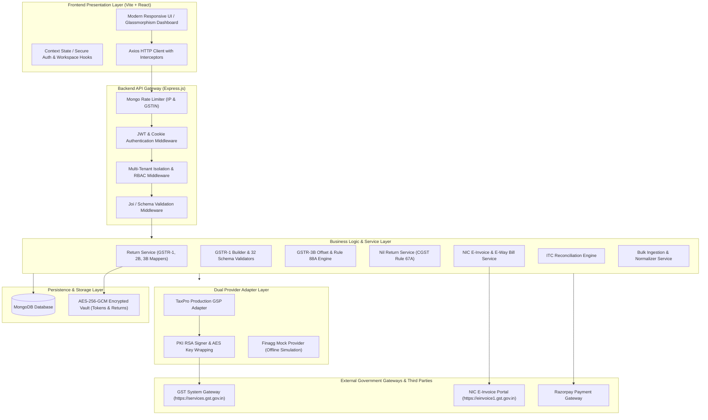
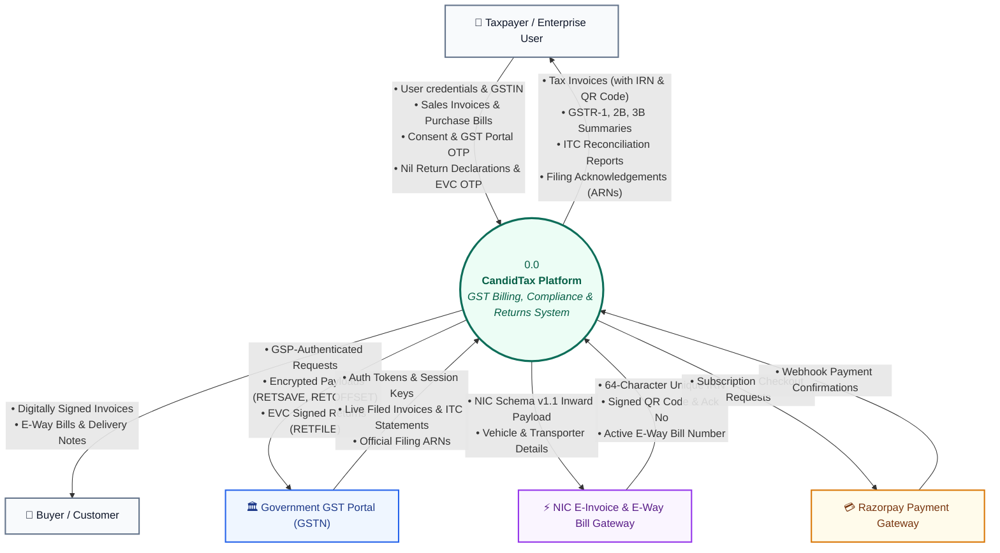
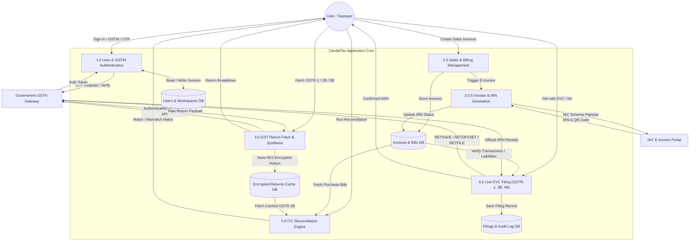
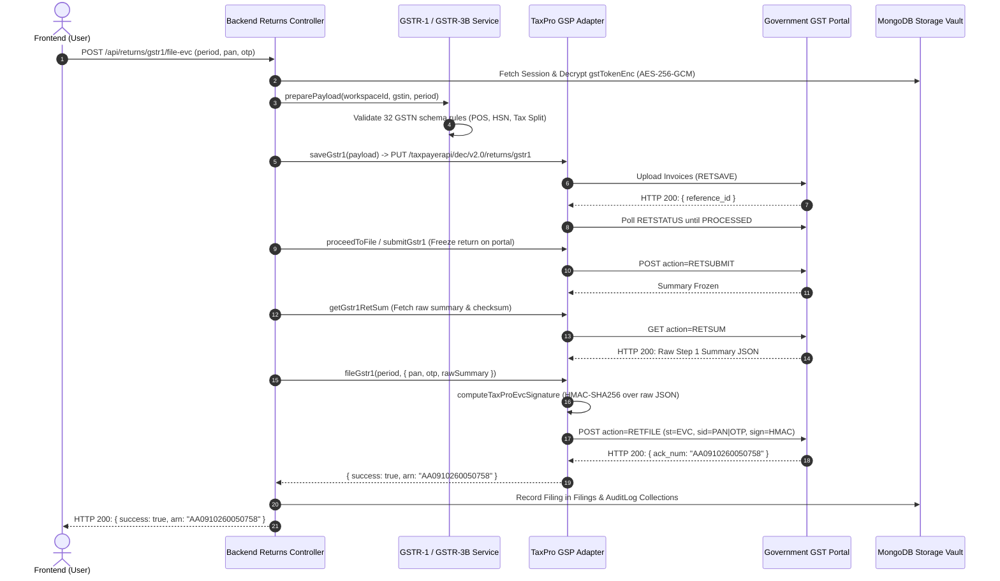
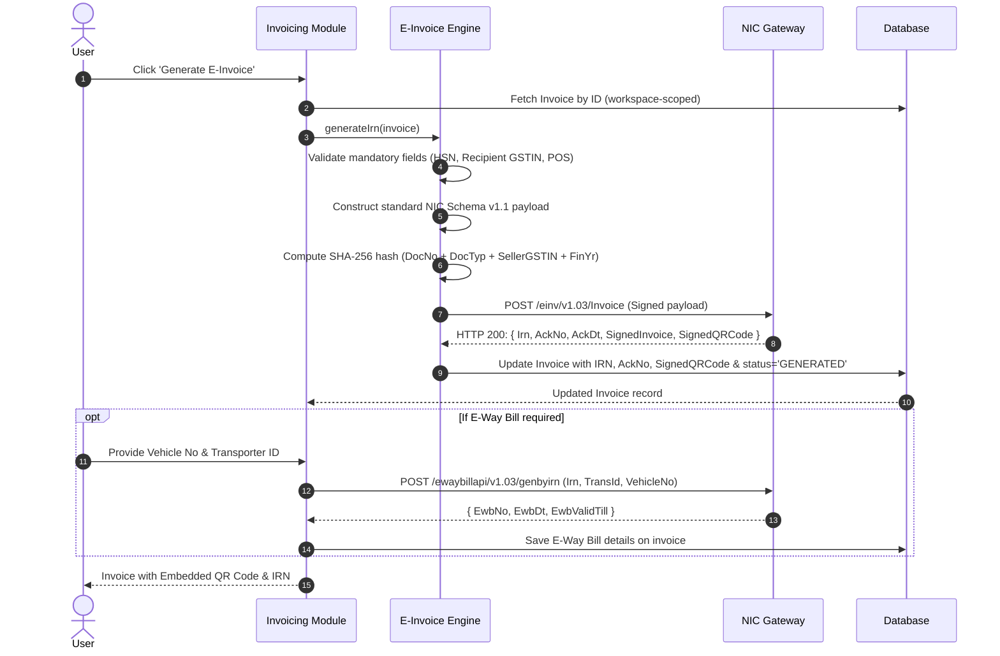

# CandidTax — Enterprise GST Billing & Compliance Platform

> **A production-ready, multi-tenant GST billing, compliance, automated return filing (GSTR-1 Regular/NIL & GSTR-3B), e-invoicing (NIC IRN / QR Code), e-way bill management, and smart ITC reconciliation platform.**

---

## 📑 Table of Contents

1. [Executive Summary](#-executive-summary)
2. [Key Features & Capabilities](#-key-features--capabilities)
3. [System Architecture & Design](#-system-architecture--design)
4. [Data Flow Diagrams (DFD)](#-data-flow-diagrams-dfd)
   - [Level 0: Context Diagram](#level-0-context-diagram)
   - [Level 1: System Data Flow Diagram](#level-1-system-data-flow-diagram)
   - [Level 2: Live GST Return Ingestion & EVC Filing Flow](#level-2-live-gst-return-ingestion--evc-filing-flow)
   - [Level 2: NIC E-Invoice & E-Way Bill Lifecycle](#level-2-nic-e-invoice--e-way-bill-lifecycle)
5. [Technology Stack](#-technology-stack)
6. [Project Directory Structure](#-project-directory-structure)
7. [Database Schema & Data Models](#-database-schema--data-models)
8. [API Endpoints Reference](#-api-endpoints-reference)
   - [1. Authentication & Workspace Management](#1-authentication--workspace-management)
   - [2. Taxpayer GSTIN & Portal Session](#2-taxpayer-gstin--portal-session)
   - [3. GST Returns Operations & Direct Live Filing](#3-gst-returns-operations--direct-live-filing)
   - [4. Sales Invoices & NIC E-Invoicing](#4-sales-invoices--nic-e-invoicing)
   - [5. Purchase Bills & Vendor Ledger](#5-purchase-bills--vendor-ledger)
   - [6. Smart Reconciliation, Reports & Bulk Ingestion](#6-smart-reconciliation-reports--bulk-ingestion)
9. [Local Development & Setup Guide](#-local-development--setup-guide)
10. [Automated Testing Suite (15/15 Suites)](#-automated-testing-suite)
11. [License & Attribution](#-license--attribution)

---

## 🌟 Executive Summary

**CandidTax** is an enterprise-grade GST billing, compliance, and direct return filing software engineered for Indian businesses, tax professionals, and enterprises. It bridges financial accounting with the Government GST System (**GSTN**) and National Informatics Centre (**NIC**) portals via authorized GSP/ASP infrastructure.

The platform provides a dual-provider architecture:
1. **Production Mode (`PROVIDER=taxpro`)**: Live, direct integration with Government GST servers via **TaxPro GSP/ASP** with PKI RSA signing, AES session key wrapping, live OTP verification, and high-performance return mappers.
2. **Sandbox / Mock Mode (`PROVIDER=mock`)**: An offline, zero-dependency mock simulator replicating official GSTN schemas, rate-limiting, edge-case error codes, and failover states for automated CI/CD testing.

---

## 🚀 Key Features & Capabilities

### 1. Invoicing & Billing Engine
- **Intelligent Tax Computation**: Automatically identifies Inter-State vs. Intra-State transactions based on Place of Supply (POS) and Seller/Buyer state codes, calculating appropriate **CGST + SGST** (50/50 split) or **IGST** (100%).
- **Multi-Line Invoicing**: Line-item level HSN/SAC codes, quantities, standard UQC units, discount percentages, and cess amounts.
- **Reverse Charge Mechanism (RCM)**: Fully compliant flags for reverse-charge inward and outward supplies.
- **Export Invoices**: Support for With-Payment (WPAY) and Without-Payment of tax (WOPAY/LUT).

### 2. Live GST Returns Management & Direct Filing
- **GSTR-1 (Outward Supplies)**:
  - Fetches and synthesizes Table 4 (B2B), Table 7 (B2CS), Table 9B (Credit/Debit Notes), Table 12 (HSN Summary), and Table 13 (Documents Issued).
  - Built-in dry-run validation against 32 strict GSTN v2.0 schema rules before dispatching to portal.
- **GSTR-1 Nil Return Filing (CGST Rule 67A)**:
  - Automated pre-check for Nil activity (zero sales, zero purchase ITC, zero liability) with one-click direct statutory filing.
- **GSTR-2B (Auto-Drafted ITC Statement)**:
  - Fetches vendor-filed ITC invoices directly from the GST portal with granular categorization.
- **GSTR-3B (Monthly Summary Liability & Offset)**:
  - Comprehensive view of outward tax liabilities (Table 3.1) and Input Tax Credit availed (Table 4).
  - Automated tax offset engine executing statutory **Rule 88A** (IGST ITC prioritized against IGST, then CGST/SGST).
  - Enforces **Section 49(4)** of the CGST Act: RCM tax liability is strictly 100% payable in cash.
- **Direct EVC Signing**:
  - Computes HMAC-SHA256 signatures over unparsed raw summaries with automatic 5-mode candidate fallback matrix.
  - Generates official government Acknowledgement Reference Numbers (ARNs) directly in-app.

### 3. NIC E-Invoicing & E-Way Bill Integration
- **Real-time IRN Generation**: Real-time generation of 64-character Invoice Reference Numbers (IRN) via NIC schema v1.1.
- **Signed QR Code & Digital Signature**: Embeds cryptographically signed QR codes and digital signatures on invoices for mobile verification.
- **E-Way Bill Generation**: Direct creation of Part-A and Part-B E-Way bills linked directly to the IRN.
- **Statutory Cancellation**: Cancellation within 24 hours with mandatory statutory cancellation reason codes.

### 4. Smart ITC Reconciliation Engine
- Automatically matches **Purchase Register (Books)** against **Government GSTR-2B**:
  - `MATCHED`: Invoice number, date, tax amounts, and GSTIN match within tolerance.
  - `MISMATCHED`: Partial match (variance in taxable value or tax amounts).
  - `MISSING_IN_2B`: Claimed in books but vendor has not filed (Vendor Risk Audit).
  - `EXTRA_IN_2B`: Available on portal but not yet claimed in books.
- **GST Refund & Liability Estimator**: Real-time estimation of net cash tax payable vs. ITC carry-forward/refund.

### 5. Multi-Tenant Workspace & Role-Based Access Control (RBAC)
- Multi-organization support: Each workspace strictly binds to a single verified **GSTIN**.
- Team hierarchy: `OWNER` (full administrative rights), `ADMIN`, `CA / TAX CONSULTANT`, `MEMBER`, and `VIEWER` (read-only audit).
- Cryptographic tenant isolation enforcing workspace boundaries across all database queries.

### 6. Bulk Data Ingestion & Financial Reports
- Excel/CSV bulk import for sales invoices and purchase bills with automated column alias mapping and date sanitization.
- Exportable Sales Register, Purchase Register, and GSTR-1 vs. GSTR-3B Variance Audit Reports.

---

## 🏗️ System Architecture & Design



---

## 📊 Data Flow Diagrams (DFD)

### Level 0: Context Diagram



---

### Level 1: System Data Flow Diagram



---

### Level 2: Live GST Return Ingestion & EVC Filing Flow



---

### Level 2: NIC E-Invoice & E-Way Bill Lifecycle



---

## 💻 Technology Stack

| Domain | Technology / Library | Purpose |
| :--- | :--- | :--- |
| **Frontend Framework** | React 18.3 + Vite 8.3 | High-performance SPA with instant HMR and optimized asset bundling |
| **Frontend Routing** | React Router DOM v6 | Client-side routing, protected auth guards, workspace switches |
| **Styling & Design** | Tailwind CSS + Bootstrap Icons | Modern responsive design system, modal workflows, clean UX |
| **Backend Runtime** | Node.js (v18+ / v20+ / v22+) | Scalable asynchronous runtime environment |
| **Backend Framework** | Express.js 4.x | RESTful API server with custom security middlewares |
| **Database** | MongoDB 6.0+ via Mongoose 8.x | Multi-tenant document database with automated TTL indexing |
| **Cryptography** | Node.js Native `crypto` | AES-256-GCM envelope encryption and HMAC-SHA256 EVC signatures |
| **PKI & Digital Signatures**| Node.js `crypto.createSign` | RSA-SHA256 signatures for TaxPro GSP authorization |
| **Authentication** | JWT, `bcryptjs`, Google Auth | Session management, password hashing, OAuth2.0 |
| **Rate Limiting** | Custom MongoDB Rate-Limit Store | Distributed rate-limiting across multi-instance clusters |
| **HTTP Client** | Axios | Resilient HTTP requests with custom timeouts and error masks |
| **Testing Engine** | Node.js Test Runner (`node:assert`) | 15 test suites, 0-leak credential verification, 100% assertions |

---

## 📁 Project Directory Structure

```text
GST_Compliance/
├── README.md                           # Comprehensive Project Documentation
├── doc/                                # API schemas and sample sandbox payloads
│   ├── einvoice-sandbox-testing.json
│   └── otprequest-error.json
│
├── Backend/                            # Node.js Express REST API
│   ├── server.js                       # Application entrypoint & graceful shutdown
│   ├── package.json                    # Backend dependencies & script definitions
│   │
│   ├── scripts/                        # Automated testing & operational tools
│   │   ├── run-all-tests.js            # Unified test runner
│   │   ├── test-taxpro.js              # Comprehensive TaxPro adapter tests
│   │   ├── test-taxpro-contracts.js    # TaxPro GSP API contract tests
│   │   ├── test-gstr1-schema-verification.js # Strict 32 schema validation tests
│   │   ├── test-evc-pipeline.js        # EVC signature & RETFILE pipeline test
│   │   ├── test-middleware.js          # Security & rate-limiting tests
│   │   ├── test-einvoice.js            # NIC E-Invoice & EWB tests
│   │   ├── test-billing.js             # Tax calculations & tenancy isolation
│   │   └── test-nil-return.js          # CGST Rule 67A statutory tests
│   │
│   └── src/
│       ├── app.js                      # Express configuration & global middleware
│       ├── controllers/                # Request handlers (Returns, Invoices, Auth, Import...)
│       ├── middleware/                 # Auth, workspaceRole, validate, rateLimiters
│       ├── models/                     # Mongoose Data Models (User, Invoice, Bill, Filing...)
│       ├── routes/                     # REST API Route Declarations
│       ├── services/                   # Business logic (gstr1, gstr3b, nilReturn, taxpro...)
│       └── utils/                      # Tax calculator, GSTIN helpers, logger, crypto
│
└── Frontend/                           # React + Vite Client Application
    ├── package.json                    # Frontend dependencies & build scripts
    ├── vite.config.js                  # Vite configuration & dev server proxy
    │
    └── src/
        ├── main.jsx                    # React root mount
        ├── App.jsx                     # Route registry & global layout
        ├── index.css                   # Global styling
        ├── api/                        # Axios API client modules
        ├── components/                 # Modals (Gstr1EvcModal, NilReturnModal, Navbar...)
        ├── context/                    # AuthContext, WorkspaceContext
        └── pages/                      # Views (GstReturnHubPage, InvoicesPage, BillsPage...)
```

---

## 🗄️ Database Schema & Data Models

### 1. `User` Model
```javascript
{
  name: { type: String, required: true },
  email: { type: String, required: true, unique: true, index: true },
  password: { type: String, select: false }, // Bcrypt hash (12 rounds)
  googleId: { type: String, sparse: true },
  role: { type: String, enum: ['SUPER_ADMIN', 'USER'], default: 'USER' },
  status: { type: String, enum: ['ACTIVE', 'SUSPENDED'], default: 'ACTIVE' }
}
```

### 2. `Workspace` Model (Multi-Tenancy Root)
```javascript
{
  name: { type: String, required: true },
  gstin: { type: String, required: true, unique: true, uppercase: true, index: true },
  tradeName: { type: String },
  legalName: { type: String },
  pan: { type: String, index: true },
  stateCode: { type: String, required: true }, // e.g. "06" (Haryana), "09" (UP)
  plan: { type: String, enum: ['FREE', 'PRO', 'ENTERPRISE'], default: 'FREE' },
  status: { type: String, enum: ['ACTIVE', 'INACTIVE'], default: 'ACTIVE' }
}
```

### 3. `Session` Model (GST Portal Auth)
```javascript
{
  userId: { type: ObjectId, ref: 'User' },
  workspaceId: { type: ObjectId, ref: 'Workspace', index: true },
  memberId: { type: ObjectId, ref: 'WorkspaceMember' },
  gstin: { type: String, required: true },
  username: { type: String, required: true },
  gstTokenEnc: { type: String }, // AES-256-GCM Encrypted Token (Never stored in plaintext)
  expiresAt: { type: Date, required: true, index: { expires: 0 } } // Auto-deleted on TTL expiry
}
```

### 4. `Invoice` Model (Sales & E-Invoice)
```javascript
{
  workspaceId: { type: ObjectId, ref: 'Workspace', required: true, index: true },
  invoiceNumber: { type: String, required: true, trim: true },
  documentType: { type: String, enum: ['INVOICE', 'CREDIT_NOTE', 'DEBIT_NOTE'], default: 'INVOICE' },
  invoiceDate: { type: Date, required: true },
  customerId: { type: ObjectId, ref: 'Customer' },
  customerName: { type: String, required: true },
  customerGstin: { type: String, uppercase: true, default: '' },
  placeOfSupply: { type: String, required: true }, // 2-digit state code (e.g., '09')
  isReverseCharge: { type: Boolean, default: false },
  isExport: { type: Boolean, default: false },
  exportType: { type: String, enum: ['WPAY', 'WOPAY', ''] },
  lineItems: [{
    name: String,
    hsnSac: String,
    unit: { type: String, default: 'PCS' },
    quantity: { type: Number, default: 1 },
    rate: Number,
    discount: { type: Number, default: 0 },
    taxableAmount: Number,
    gstRate: Number,
    cgstAmount: Number,
    sgstAmount: Number,
    igstAmount: Number,
    totalAmount: Number
  }],
  subTotal: Number,
  totalCgst: Number,
  totalSgst: Number,
  totalIgst: Number,
  grandTotal: Number,
  // NIC E-Invoice fields
  einvoiceStatus: { type: String, enum: ['NOT_APPLICABLE', 'PENDING', 'GENERATED', 'CANCELLED'], default: 'NOT_APPLICABLE' },
  irn: { type: String, index: true },
  signedQrCode: { type: String }
}
```

### 5. `Bill` Model (Purchase Invoices for GSTR-3B ITC)
```javascript
{
  workspaceId: { type: ObjectId, ref: 'Workspace', required: true, index: true },
  billNumber: { type: String, required: true },
  vendorName: { type: String, required: true },
  vendorGstin: { type: String, uppercase: true, default: '' },
  placeOfSupply: { type: String, default: '' },
  isReverseCharge: { type: Boolean, default: false }, // Enforces 100% Cash Payment under Sec 49(4)
  itcEligible: { type: Boolean, default: true },      // Eligible for Table 4(A)(5) ITC claim
  billDate: { type: Date, required: true },
  category: { type: String, enum: ['Inventory', 'Expense', 'Asset', 'Service'], default: 'Expense' },
  lineItems: [{
    description: String,
    hsnSac: String,
    quantity: Number,
    rate: Number,
    taxableAmount: Number,
    gstRate: Number,
    cgstAmount: Number,
    sgstAmount: Number,
    igstAmount: Number,
    totalAmount: Number
  }],
  grandTotal: Number
}
```

### 6. `Filing` Model (Government Filing Records)
```javascript
{
  workspaceId: { type: ObjectId, ref: 'Workspace', required: true, index: true },
  gstin: { type: String, required: true },
  returnType: { type: String, enum: ['GSTR1', 'GSTR3B'], required: true },
  period: { type: String, required: true }, // MMYYYY (e.g. '102026')
  arn: { type: String, required: true },    // Government Acknowledgement Reference Number
  isNil: { type: Boolean, default: false },
  verificationMode: { type: String, enum: ['EVC', 'DSC'], default: 'EVC' },
  filedAt: { type: Date, default: Date.now }
}
```

### 7. `Return` Model (Cached Government Payload)
```javascript
{
  workspaceId: { type: ObjectId, ref: 'Workspace', index: true },
  gstin: { type: String, required: true, uppercase: true, index: true },
  type: { type: String, enum: ['GSTR1', 'GSTR2B', 'GSTR3B'], required: true },
  period: { type: String, required: true }, // MMYYYY format
  dataEnc: { type: String, required: true }, // AES-256-GCM Encrypted Return Data
  fetchedAt: { type: Date, default: Date.now }
}
```

---

## 📡 API Endpoints Reference

### 🔐 1. Authentication & Workspace Management

| Method | Endpoint | Description | Auth Required |
| :--- | :--- | :--- | :--- |
| `POST` | `/api/auth/signup` | Register a new user account | No |
| `POST` | `/api/auth/signin` | Login with email and password | No |
| `POST` | `/api/auth/google` | Sign in with Google OAuth token | No |
| `GET` | `/api/auth/me` | Fetch active user profile and session | Yes (Cookie) |
| `POST` | `/api/auth/logout` | Revoke session and clear cookies | Yes (Cookie) |
| `GET` | `/api/auth/workspaces` | List all workspaces accessible by user | Yes (Cookie) |
| `POST` | `/api/auth/workspace/switch` | Switch active workspace context | Yes (Cookie) |

---

### 🏛️ 2. Taxpayer GSTIN & Portal Session

| Method | Endpoint | Description | Auth Required |
| :--- | :--- | :--- | :--- |
| `POST` | `/api/auth/otp/request` | Dispatch 6-digit OTP from portal to mobile/email | Yes (`consent: true`) |
| `POST` | `/api/auth/otp/verify` | Verify OTP, receive GST auth token, encrypt into session | Yes |
| `POST` | `/api/auth/token/refresh`| Silently refresh active GST auth token | Yes |
| `POST` | `/api/gstin/search` | Public search for taxpayer legal name, trade name, status | No (Rate-limited) |

---

### 📑 3. GST Returns Operations & Direct Live Filing

| Method | Endpoint | Description | Roles Allowed |
| :--- | :--- | :--- | :--- |
| `GET` | `/api/returns/summary` | Return filing overview across financial years (`RETTRACK`) | All Members |
| `GET` | `/api/returns/gstr1` | Fetch live GSTR-1 return breakdown (B2B, B2CS, HSN) | All Members |
| `GET` | `/api/returns/gstr1/prepare` | Synthesize GSTR-1 JSON from local sales invoices | All Members |
| `POST` | `/api/returns/gstr1/save` | Upload/Save GSTR-1 payload to Government GST portal (`RETSAVE`) | `OWNER`, `ADMIN`, `CA` |
| `POST` | `/api/returns/evc-otp` | Dispatch fresh EVC OTP to Signatory mobile/email | `OWNER`, `ADMIN`, `CA` |
| `POST` | `/api/returns/gstr1/file-evc` | **Live GSTR-1 Filing** with EVC signature (`RETFILE`) -> ARN | `OWNER`, `ADMIN`, `CA` |
| `POST` | `/api/returns/nil-file` | **Live Nil Return Filing** (Rule 67A) for GSTR-1 or 3B -> ARN | `OWNER`, `ADMIN`, `CA` |
| `GET` | `/api/returns/gstr2b` | Fetch live auto-drafted GSTR-2B ITC statement | All Members |
| `GET` | `/api/returns/gstr3b` | Fetch live GSTR-3B monthly liabilities & ITC breakdown | All Members |
| `POST` | `/api/returns/gstr3b/save` | Save GSTR-3B payload to Government portal (`RETSAVE`) | `OWNER`, `ADMIN`, `CA` |
| `POST` | `/api/returns/gstr3b/offset` | Settle tax liability via Rule 88A & cash ledger (`RETOFFSET`)| `OWNER`, `ADMIN`, `CA` |
| `POST` | `/api/returns/gstr3b/file-evc`| **Live GSTR-3B Filing** with EVC verification (`RETFILE`) -> ARN | `OWNER`, `ADMIN`, `CA` |
| `GET` | `/api/returns/filing-history`| View all past filed returns with timestamps and ARNs | All Members |

---

### 🧾 4. Sales Invoices & NIC E-Invoicing

| Method | Endpoint | Description | Roles Allowed |
| :--- | :--- | :--- | :--- |
| `GET` | `/api/invoices` | List invoices with pagination, search, and filters | All Members |
| `POST` | `/api/invoices` | Create a new sales invoice with automatic tax computation | `OWNER`, `ADMIN`, `MEMBER` |
| `GET` | `/api/invoices/:id` | Get full invoice details and line items | All Members |
| `PUT` | `/api/invoices/:id` | Update invoice (if not IRN generated) | `OWNER`, `ADMIN`, `MEMBER` |
| `DELETE`| `/api/invoices/:id` | Delete invoice | `OWNER`, `ADMIN` |
| `POST` | `/api/invoices/:id/einvoice` | Generate NIC E-Invoice (64-char IRN, Signed QR Code) | `OWNER`, `ADMIN` |
| `POST` | `/api/invoices/:id/ewaybill` | Generate linked E-Way Bill (Part-A / Part-B) | `OWNER`, `ADMIN` |
| `POST` | `/api/invoices/:id/cancel-einvoice`| Cancel IRN on NIC portal within 24 hours | `OWNER`, `ADMIN` |

---

### 📥 5. Purchase Bills & Vendor Ledger

| Method | Endpoint | Description | Roles Allowed |
| :--- | :--- | :--- | :--- |
| `GET` | `/api/bills` | List purchase bills with vendor search and status filters | All Members |
| `POST` | `/api/bills` | Record a new purchase bill (marks ITC eligibility & RCM) | `OWNER`, `ADMIN`, `MEMBER` |
| `GET` | `/api/bills/:id` | View purchase bill details | All Members |
| `PUT` | `/api/bills/:id` | Update purchase bill | `OWNER`, `ADMIN`, `MEMBER` |
| `DELETE`| `/api/bills/:id` | Delete purchase bill | `OWNER`, `ADMIN` |

---

### ⚖️ 6. Smart Reconciliation, Reports & Bulk Ingestion

| Method | Endpoint | Description | Roles Allowed |
| :--- | :--- | :--- | :--- |
| `GET` | `/api/reconciliation` | Run automated matching between Purchase Bills and GSTR-2B | All Members |
| `GET` | `/api/reports/sales` | Aggregate Sales Register report within custom date range | All Members |
| `GET` | `/api/reports/purchases`| Aggregate Purchase Register report within custom date range| All Members |
| `GET` | `/api/reports/gstr-comparison`| GSTR-1 vs. GSTR-3B tax variance and liability audit | All Members |
| `POST` | `/api/import/invoices` | Bulk upload sales invoices via `.xlsx` or `.csv` | `OWNER`, `ADMIN` |
| `POST` | `/api/import/bills` | Bulk upload purchase bills via `.xlsx` or `.csv` | `OWNER`, `ADMIN` |

---

## ⚙️ Local Development & Setup Guide

### Prerequisites
- **Node.js**: v18.0.0 or higher (v20+ recommended)
- **MongoDB**: v6.0 or higher running locally on port `27017`
- **Git**: Installed and configured

### Step 1: Clone Repository
```bash
git clone https://github.com/vikramKumar-code/GST-Comliance.git
cd GST-Comliance
```

### Step 2: Configure Environment
Set up your local environment configuration file in the `Backend/` directory:
```bash
cd Backend
# Create and configure your environment file before running the server
```

### Step 3: Install Dependencies
```bash
# Install Backend dependencies
cd Backend
npm install

# Install Frontend dependencies
cd ../Frontend
npm install
```

### Step 4: Run Application
Open two separate terminal windows:

**Terminal 1 (Backend Server):**
```bash
cd Backend
npm run dev
# Server starts on port 5000
```

**Terminal 2 (Frontend Client):**
```bash
cd Frontend
npm run dev
# Client starts on http://localhost:5173
```

Visit **`http://localhost:5173`** in your browser to access the CandidTax portal.

---

## 🧪 Automated Testing Suite

The repository contains an automated offline and integration testing framework covering all operational layers:

```bash
cd Backend
npm run test:all
```

### Test Suite Highlights:
1. **`test-taxpro`**: Verifies zero-leak logs, RSA signature generation, AES key wrapping, and TaxPro adapter contracts.
2. **`test-taxpro-contracts`**: Verifies all 8 live API contracts for TaxPro GSP profile compatibility.
3. **`test-gstr1-schema-verification`**: Verifies all 32 strict GSTN v2.0 schema validation rules.
4. **`test-evc-pipeline`**: Tests the complete 3-step EVC flow (`RETSUM` → `EVCOTP` → `RETFILE`) and HMAC-SHA256 signature verification.
5. **`test-filing-mode`**: Validates fail-closed safety assertions ensuring live filing executes only in authorized modes.
6. **`test-nil-return`**: Validates CGST Rule 67A statutory compliance and ARN receipt generation.
7. **`test-itc-reconciliation`**: Asserts matching engine logic (`MATCHED`, `MISMATCHED`, `MISSING_IN_2B`).
8. **`test-billing`**: Tests multi-item tax math, inter/intra tax splitting, and Place of Supply rules.
9. **`test-einvoice`**: Validates NIC Schema v1.1 compliance, SHA-256 IRN hashing, and cancellation rules.
10. **`test-middleware`**: Validates rate-limiting, error handling, session cookies, and request validation.

---

## 📄 License & Attribution

Distributed under the **MIT License**. See `LICENSE` for more information.

Developed for Indian businesses, tax consultants, and Chartered Accountants.
